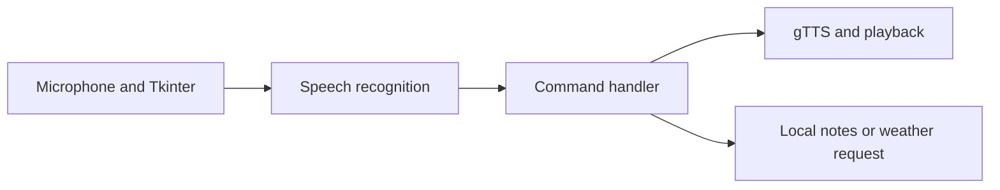

# Lavinya Voice Assistant

## Overview

Turkish-language desktop voice assistant with a Tkinter interface.

## Features

Speech input and output, local note management, and a weather lookup.

## Tech stack

Python, Tkinter, SpeechRecognition, gTTS, pygame, Requests and Beautiful Soup.

## Architecture



## Installation

```bash
python -m pip install "SpeechRecognition[audio]" gTTS pygame requests beautifulsoup4
python lavinya.py
```

Install Tkinter and any audio system dependencies required by the operating system.

## Environment variables

No environment variable contract is documented. A microphone and network connectivity are needed for network-backed operations.

## Usage

Enable the assistant in the window and speak a Turkish command. Use synthetic notes for initial testing.

## Tests

No maintained automated test command was found. Run `python -m py_compile lavinya.py` as a syntax check, then manually test microphone, playback and note handling.

## Security

Keep saved notes out of Git. Network-backed speech and weather operations should be used only with information suitable for their providers.

## Project status

Public prototype. The install command is derived from imports. Microphone, audio and live weather were not tested in this phase.
